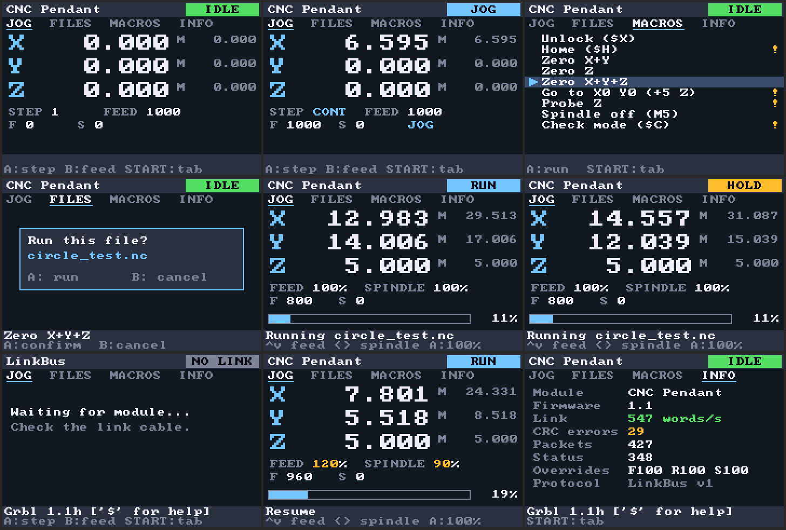

# gbc-cnc — LinkBus GBA link-port modules

> Despite the repo name, this needs a **Game Boy Advance** (GBA, SP, Micro or Game Boy Player): GBC mode has no multiboot and uses 5 V link levels. See [docs/HARDWARE.md](docs/HARDWARE.md).

Plug a module into the GBA's link port and the module boots its own GBA program over the cable (multiboot), with no cartridge needed. The GBA then becomes that module's screen and controller. One cable with a keyed coupler, swappable modules.

The first module is a **CNC pendant** for the Genmitsu 3020 (GRBL). It gives you a position readout (DRO), continuous and step jogging, zeroing, Z probing, and running G-code files, with feed hold, resume and a safe stop.



*(Real output: the GBA code rendered by the host simulation in `test/`.)*

```
linkbus/
├── shared/linkbus_proto/     framing, CRC, ring buffer, message IDs — compiled by GBA and ESP
├── gba/common/               GBA side: SIO slave driver (lb_gba), Mode-3 text, font, registers
├── gba/pendant/              CNC pendant ROM (multiboot)          → pendant_mb.gba
├── esp/lib/LinkBus/          module side: LinkMaster (multiboot + link), reusable
├── esp/src/                  CNC module: GRBL streamer, jog, macros, web upload, OTA
├── docs/PROTOCOL.md          LinkBus v1 spec — read this before writing a new module
├── docs/HARDWARE.md          link-port pinout, coupler standard, ESP-12F + GRBL wiring, BOM
└── test/                     host tests + full end-to-end simulation (run_tests.sh)
```

## Build

**GBA ROM** (devkitPro with `gba-dev`):

```sh
cd gba/pendant
make            # -> pendant_mb.gba (~12 KB)
make install    # copies it to esp/data/rom/pendant.gba
```

**ESP module** (PlatformIO). Edit `esp/src/config.h` first: Wi-Fi, axis inversion, feed limits, probe thickness, macros.

```sh
cd esp
pio run -e esp12f -t upload      # firmware (GRBL wires off GPIO1/3 while flashing over USB)
pio run -e esp12f -t uploadfs    # LittleFS: ROM + any G-code in data/gcode/
pio run -e ota -t upload         # later updates over Wi-Fi (linkbus-cnc.local)
```

**Tests** (gcc/g++; `arm-none-eabi-gcc` optional):

```sh
./test/run_tests.sh
```

## Bring-up order (real hardware)

1. **Link only.** Wire the ESP to the coupler and leave GRBL disconnected. Power the ESP, then switch the GBA on with **no cartridge**. Within about a second the pendant appears and shows `OFFLINE`, meaning no GRBL yet.
   - If it doesn't, open `http://linkbus-cnc.local`. The bottom line shows the multiboot result plus retry and CRC counters.
   - Slow the clock (`bitHalfUs = 4` in `LinkMaster.h`) if you see CRC errors on a long cable.
2. **GRBL, motors safe.** Connect TX/RX/GND (see HARDWARE.md). The pill should go `IDLE` (or `ALARM`: use MACROS → Unlock). Nudge the machine by hand and the DRO should follow.
3. **Directions.** Use step mode at 1 mm. D-pad **Right = +X**, **Up = +Y**, **R = +Z up**, **L = Z down**. Flip `JOG_INVERT_*` in `config.h` if your machine disagrees.
4. **Dry run.** Use MACROS → `Check mode ($C)` and run a file; GRBL parses everything without moving. Run the same macro again to leave check mode.
5. **Air cut.** Zero with Z a few mm above the stock, run the job, and confirm hold, resume and STOP feel right before cutting.

## Controls

| | JOG | FILES | MACROS |
|---|---|---|---|
| D-pad | jog X/Y (step or continuous) · **during a job:** ↑↓ feed override ±10 %, →← spindle ±10 % | move cursor (←/→ page) | move cursor |
| L / R | jog Z down / up | — | — |
| A | step size: CONT · 0.01 · 0.1 · 1 · 10 mm · **during a job:** overrides back to 100 % | run file (confirm) | run macro (some confirm) |
| B | jog feed: 100 · 300 · 600 · 1000 · 2000 | reload list | — |
| START | next tab (JOG → FILES → MACROS → INFO) | next tab | next tab |
| SELECT | **press: feed hold** · tap while held: resume · **hold 0.75 s: STOP** | same | same |

The **INFO** tab shows module name and firmware, link rate (words/s), CRC errors, packet counters and the live overrides. Check it first when bringing up new hardware.

STOP is a feed hold, then a soft reset once GRBL reports it has stopped, so machine position is kept and there's no alarm. It works the same from the web UI.

## What's verified, and how

`test/run_tests.sh` builds the **real** GBA code and the **real** module code for the host and connects them through a bit-level model of the link port and a fake GRBL 1.1 (128-byte RX buffer, 15-block planner). The GBA starts in a model of the multiboot BIOS, and the module uploads the actual compiled ROM image. Checked, all passing:

- **Multiboot:** the image arrives byte-exact with the CRC accepted, ~12 KB in about 0.4 s.
- **Link reliability:** about 1,600 "GBA not armed" transfers (random ISR latency up to 400 µs) are recovered by retransmit. Corrupted words are caught by CRC and the link resyncs.
- **Continuous jog:** 1 s held at 1000 mm/min gives 16.55 mm. The planner never holds more than 0.21 s of jog.
- **Step jog** is exact. **Zero** macros set the work offset without moving.
- **Job streaming:** 302/302 motion lines executed, with GRBL's RX buffer at a maximum of 127/128.
- **Hold / resume / STOP:** STOP leaves no alarm and position is kept.
- **Feed and spindle overrides** from the D-pad mid-job: GRBL, the reported feed and the GBA display all agree, and A resets them.
- **Pulling the cable mid-jog:** the module's dead man cancels within 150 ms. Re-plugging resumes without a re-boot.
- **Bad files:** an over-long line or a GRBL `error:` stops the job safely.

**Not yet verified on real hardware:**

- **ESP firmware against the real ESP8266 core.** This repo's ESP code was compiled against a host Arduino shim, because the PlatformIO registry wasn't reachable from the build machine. Expect the first `pio run` to be clean or need trivial API fixes.
- **Real multiboot timing on a GBA.** The protocol matches the well-known Arduino uploaders, but the 200 kHz clock and inter-word gaps are tunables if a GBA disagrees.
- **Whether your Genmitsu board's header is a usable UART.** See HARDWARE.md before connecting anything.

## Next modules (same cable, same coupler)

- **Wardriver (`0x0002`).** Reuse `LinkMaster` plus a list screen: networks as `LIST_ENTRY` items with RSSI in `arg`.
- **Anything with an ESP:** the bench PSU controller, a serial terminal for the home lab, the hitbox as a GBA input bridge. Each module carries its own ROM in `/rom/`.
